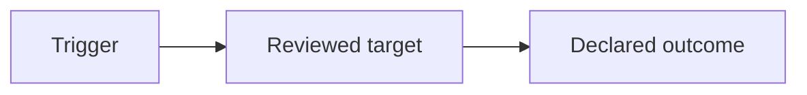

# Extended report.md

Use this reference only when the user explicitly requests a deep report file.
The chat report stays compact (see [`report-layout.md`](report-layout.md)).
Write `.review/<YYYYMMDD>-review-<slug>/report.md` only when the user asks for
it, and never create it by default. Use the same verdict, evidence-outcome,
and finding vocabulary as `SKILL.md`. Write the report in the language of the
current chat.

## Layout

Keep the sections in this order. Omit a section that adds nothing, except the
metadata header, executive summary, evidence register, and order of work.

### Metadata header

Record the target, artifact class, review date, scope, anti-scope, declared
baseline or its absence, reviewer role, and the verdict and evidence outcome.

### Executive summary

Give the verdict and the evidence outcome, followed by a one-sentence reason.

### Framing table

A four-item table: intended use, audience, decision context, and risk
tolerance. Mark each item `declared`, `inferred`, or `unknown`.

### End-to-end diagram

One Mermaid diagram of the in-scope flow, from trigger to completion and
failure. Use the smallest diagram that shows the relationship, keep it
theme-neutral, and state the controlling conclusion in prose so the report
still reads when the diagram is not rendered.

### Recommendations

Include this section only when a proposal is in scope and a substantive change
would move the decision. Omit it otherwise; do not emit an empty heading. Each
recommendation has:

- a Before/After Mermaid pair showing the current and the proposed shape,
- Tradeoffs, naming what the change costs and what it does not solve,
- a Conclusion, stating whether the recommendation should be adopted.

### Coverage matrix

Optional. Use it when several profiles or lenses were applied, to show which
were applied, which were not applicable, and which were blocked by evidence
gaps.

### Numbered findings

Each finding is numbered and keeps the `Problem`, `Suggestion`, and `Why`
fields, with independent severity and confidence. Each finding includes:

- an `Action` line stating what the owner should decide or verify,
- a flow Mermaid diagram when the finding concerns a sequence or handoff,
- Verbatim snippet of 5-15 lines with its `path:line` anchor,
- an example that shows the consequence,
- the direction for closure and its limits,
- sources, and the evidence status (`[documented]`, `[observed]`,
  `[proposed]`, or `[unknown]`).

### Notes and counter-validation

Record the strongest contrary explanation tested, any concern left unsupported,
and known limits of the review.

### Evidence and checks register

List each check or inspection with its command or source and its actual
result (`passed`, `failed`, `not-run`, or `not-applicable`). Derive counts
from commands run in the session, and report `not-run` for anything not run.

### Order of work

A numbered list of the decision-relevant follow-up, ordered by materiality.
